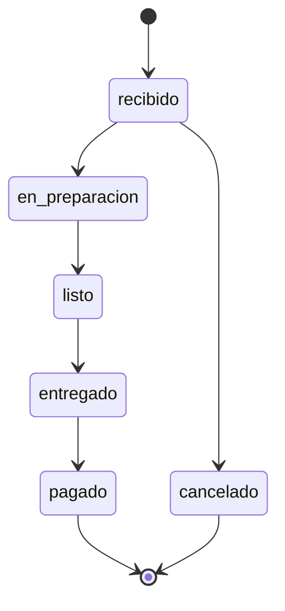
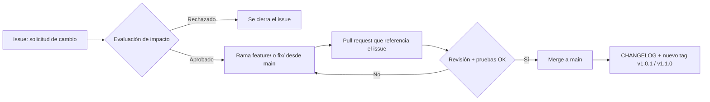

# SIGR – Sistema Integral de Gestión de Restaurante

> **Taller AA2 · Unidad 2 (Gestión de la configuración): línea base del software de restaurante**
> Universidad Tecnológica del Oriente · Ingeniería de Software · Gestión del Software 20262 – N6 Gr B
> Docente: Ing. Carlos Carrascal Avendaño · Desarrollado por: William Augusto Guevara Bocanegra (trabajo individual)


Este repositorio es la evidencia del taller. Contiene la **línea base del código fuente** del SIGR: la primera versión estable y aprobada del sistema. Es el punto de referencia para controlar los cambios futuros. El documento del taller (`Taller_LineaBase_SIGR.pdf`) describe cada decisión, y todo lo que dice se puede comprobar aquí.

---

## 1. Identificación de la línea base

| Campo | Valor |
|---|---|
| Línea base | Código fuente SIGR **v1.0.0** |
| Identificador | Tag anotado [`v1.0.0`](https://github.com/William-Guevara/sigr/tree/v1.0.0) |
| Commit | `26276b0` (`26276b0a5d4ec99c8a6fe9066cbdeabffe41b2ee`) |
| Rama estable | `main` |
| Commits incluidos | 11, desde `e78374b` hasta `26276b0` |
| Fecha de creación | 10/11/2026 |
| Validada y aprobada por | William Augusto Guevara Bocanegra (roles de desarrollo y coordinación) |

> La rama `main` puede avanzar con cambios aprobados. **El tag `v1.0.0` no se mueve nunca**: es la referencia para comparar y para volver a un estado estable.

## 2. Cómo verificar la línea base en 2 minutos

```bash
git clone https://github.com/William-Guevara/sigr.git
cd sigr
git checkout v1.0.0                      # posicionarse exactamente en la línea base
git show v1.0.0 --no-patch               # quién la creó, cuándo y con qué mensaje
git log --oneline v1.0.0                 # los 11 commits incluidos
python -m unittest discover -s tests -t . -v
```

Resultado esperado de las pruebas:

```
test_cierre_de_caja_del_dia ... ok
test_crud_de_categorias ... ok
test_crud_de_platos ... ok
test_flujo_completo_de_un_pedido ... ok
test_login_con_clave_incorrecta ... ok
test_no_permite_reservar_mesa_ocupada ... ok
test_pedido_no_salta_estados ... ok
test_registro_publico_crea_solo_clientes ... ok
test_rutas_protegidas_por_rol ... ok
test_salud ... ok
----------------------------------------------------------------------
Ran 10 tests

OK
```

## 3. Componentes incluidos

| Módulo | Archivo | Qué hace |
|---|---|---|
| Autenticación | [`sigr/auth.py`](sigr/auth.py) | Registro de clientes, creación de personal, login con token y permisos por rol (cliente, mesero, administrador) |
| Menú digital | [`sigr/menu.py`](sigr/menu.py) | CRUD de categorías y platos; baja lógica de platos |
| Pedidos | [`sigr/pedidos.py`](sigr/pedidos.py) | Pedidos por mesa con cálculo del total y seguimiento por estados |
| Reservas | [`sigr/reservas.py`](sigr/reservas.py) | Reservas por fecha y hora, sin cruces de mesa en una franja de 2 horas |
| Caja | [`sigr/caja.py`](sigr/caja.py) | Reporte de ventas del día y cierre de caja único por fecha |

Otros elementos de configuración de la línea base: [`db/schema.sql`](db/schema.sql), [`tests/`](tests), [`requirements.txt`](requirements.txt) y la documentación de la sección 6.

**Fuera del alcance de la v1.0.0**, para tramitar como cambios evolutivos:
- notificaciones de pedidos en tiempo real;
- facturación electrónica.

### Estados de un pedido



Cualquier salto distinto (por ejemplo, de `recibido` a `pagado`) se rechaza con el código `409`.

## 4. Criterios con los que se aprobó

| Criterio de la guía | Evidencia en el repositorio | Estado |
|---|---|---|
| Todos los módulos iniciales se compilan correctamente | La aplicación carga y registra las rutas de los cinco módulos; cada commit del historial carga sin errores | ✅ |
| Funcionalidades críticas operativas y validadas | Pruebas de login, roles, CRUD del menú, flujo de pedidos, reservas y cierre de caja | ✅ |
| Pruebas básicas de integración completadas | 10 de 10 pruebas OK ([`tests/test_integracion.py`](tests/test_integracion.py)) | ✅ |
| Estructura de carpetas y convenciones definidas | Sección 7 de este README | ✅ con observación* |
| Documentación técnica mínima adjunta | README, estructura de BD y manual de despliegue | ✅ |

\* Varias consultas SQL y pruebas superan los 79 caracteres por línea que pide PEP 8. Quedó registrado en el [CHANGELOG](CHANGELOG.md) para la siguiente versión.

## 5. Historial incluido en la línea base

| Hash | Mensaje |
|---|---|
| `e78374b` | chore: estructura inicial del proyecto, esquema de base de datos y licencia MIT |
| `9800ffa` | feat(auth): registro, login con token y control de acceso por rol |
| `2336426` | feat(menu): CRUD de categorías y platos del menú digital |
| `d6dd3e5` | feat(pedidos): registro de pedidos y seguimiento por estados |
| `77113f0` | feat(reservas): reservas por fecha y hora con validación de mesa ocupada |
| `5fb363e` | feat(caja): reporte de ventas diario y cierre de caja |
| `f18f095` | test: pruebas básicas de integración de los cinco módulos |
| `662248e` | fix(menu): rechazar precios booleanos en la validación de platos |
| `696f083` | docs: README, estructura de base de datos y manual de despliegue |
| `27da20e` | feat(menu): editar y eliminar categorías del menú |
| `26276b0` | chore(release): versión 1.0.0, línea base del código fuente |

## 6. Documentación asociada

| Archivo | Contenido |
|---|---|
| [`CHANGELOG.md`](CHANGELOG.md) | Historial de cambios hasta la v1.0.0 (formato *Keep a Changelog*) |
| [`LICENSE.txt`](LICENSE.txt) | Licencia MIT |
| [`docs/estructura_bd.md`](docs/estructura_bd.md) | Tablas, relaciones y decisiones de diseño de la base de datos |
| [`docs/manual_despliegue.md`](docs/manual_despliegue.md) | Despliegue en un entorno de pruebas a partir del tag |

## 7. Control de cambios después de la línea base

Ningún cambio entra directo a `main`. El flujo es este:



- **Ramas:** `main` es la estable; el trabajo va en `feature/<tema>`, `fix/<tema>`, `hotfix/<tema>` o `docs/<tema>`.
- **Commits:** prefijo de tipo y módulo, por ejemplo `feat(menu): ...`, `fix(caja): ...`, `docs: ...`.
- **Versiones:** versionado semántico (MAYOR.MENOR.PARCHE). Una corrección es la v1.0.1, una funcionalidad compatible la v1.1.0 y un cambio que rompe la API la v2.0.0.
- **Protección:** `main` protegida, sin `push --force` y con revisión obligatoria en cada pull request.

Este mismo README se actualizó siguiendo ese flujo: el cambio se hizo en la rama `docs/readme-entrega` y se integró por pull request, sin tocar el tag `v1.0.0`.

## 8. Ejecutar el sistema

Requisitos: Python 3.11 o superior.

```bash
python -m venv .venv
.venv\Scripts\activate                   # Linux o macOS: source .venv/bin/activate
pip install -r requirements.txt
flask --app sigr init-db
flask --app sigr auth crear-admin admin@restaurante.co
flask --app sigr run
```

La API queda en `http://127.0.0.1:5000`. Para comprobar que responde: `GET /salud`.

<details>
<summary><strong>Endpoints de la API (v1.0.0)</strong></summary>

| Método | Ruta | Rol requerido |
|---|---|---|
| GET | `/salud` | Público |
| POST | `/auth/registro` | Público (crea clientes) |
| POST | `/auth/login` | Público |
| POST | `/auth/usuarios` | Administrador |
| GET | `/menu/categorias`, `/menu/platos` | Público |
| POST, PUT, DELETE | `/menu/categorias[/<id>]`, `/menu/platos[/<id>]` | Administrador |
| POST, GET | `/pedidos` | Mesero o administrador |
| GET | `/pedidos/<id>` | Mesero o administrador |
| PATCH | `/pedidos/<id>/estado` | Mesero o administrador |
| POST | `/reservas` | Cualquier usuario autenticado |
| GET | `/reservas?fecha=AAAA-MM-DD` | Mesero o administrador |
| DELETE | `/reservas/<id>` | El cliente dueño de la reserva, un mesero o un administrador |
| GET | `/caja/reporte?fecha=AAAA-MM-DD` | Administrador |
| POST | `/caja/cierre` | Administrador |

</details>

## Estructura del repositorio

```
sigr/
├── sigr/                  # código de la aplicación (un archivo por módulo)
├── db/schema.sql          # esquema de la base de datos
├── tests/                 # pruebas de integración
├── docs/                  # estructura de BD y manual de despliegue
├── CHANGELOG.md
├── LICENSE.txt
└── requirements.txt
```

## Licencia

MIT. Ver [`LICENSE.txt`](LICENSE.txt).
